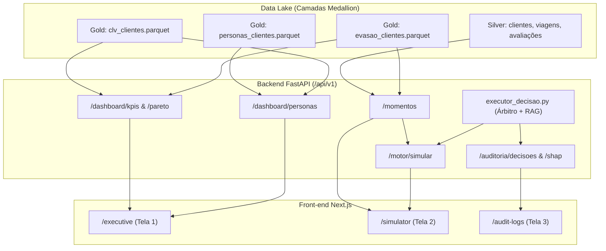

# Relatório Técnico de Diagnóstico e Integração: Front-end (Projeto Azul)

**Data de Emissão:** 21 de Outubro de 2026  
**Autor:** Arquiteto de Software & Engenharia de Dados  
**Público-Alvo:** Equipe de Desenvolvimento Full-Stack e Agentes de IA (Pair Programming)  
**Objetivo:** Mapear a arquitetura, stack, consumo de dados e contratos de integração do Front-end com o Backend Analítico (Data Lake Silver/Gold e Motor de Decisão).

---

## 1. Visão Geral e Resumo Executivo

O Front-end do projeto **Motor de Retenção Azul** foi desenvolvido utilizando uma arquitetura modular moderna orientada a recursos (*feature-based architecture*) em **Next.js 14**.

### Principais Constatações:
1. **Consumo 100% RESTful**: O front-end **não** acessa diretamente os arquivos `.parquet` do Data Lake (`data_lake/silver/` ou `data_lake/gold/`). Todas as telas consom a API RESTful padronizada na rota base `/api/v1`.
2. **Modo Demonstração Embutido (`isDemoMode`)**: Há um mecanismo de contingência em [demo-mode-context.tsx](front/src/components/providers/demo-mode-context.tsx) e [demo-data.ts](front/src/lib/demo-data.ts). Por padrão, `isDemoMode = false`, o que faz a aplicação buscar ativamente o backend em `http://localhost:8000/api/v1` (ajustável via variável de ambiente `NEXT_PUBLIC_API_URL`).
3. **Contrato Formal Estabelecido**: Os tipos e endpoints esperados pelo front-end estão documentados na raiz do repositório em [contract.md](contract.md) e espelhados em TypeScript em [src/types/api.ts](front/src/types/api.ts).

---

## 2. Estrutura de Diretórios

O código-fonte do front-end está concentrado em `azul/front/`:

```text
azul/front/
├── package.json                   # Dependências e scripts npm
├── next.config.mjs                # Configuração do Next.js
├── tailwind.config.ts             # Configuração do Tailwind CSS
├── tsconfig.json                  # Configuração TypeScript
├── Dockerfile                     # Containerização do Front-end
├── public/                        # Ativos visuais estáticos (logo.png, aba.png)
└── src/
    ├── app/                       # Next.js App Router (Páginas e Layouts)
    │   ├── layout.tsx             # Root layout com Providers (Theme, Query, DemoMode)
    │   ├── page.tsx               # Redirecionamento da raiz para /executive
    │   └── (dashboard)/           # Grupo de rotas autenticadas do dashboard
    │       ├── executive/page.tsx # Tela 1: Painel Executivo
    │       ├── simulator/page.tsx # Tela 2: Central de Decisões
    │       └── audit-logs/page.tsx# Tela 3: Logs e Explicabilidade SHAP
    ├── components/
    │   ├── shared/                # Layout comum (sidebar, navbar, header, theme-toggle)
    │   ├── providers/             # React Context Providers (TanStack Query, DemoMode, Theme)
    │   └── ui/                    # Componentes atômicos shadcn/radix (card, button, table, badge)
    ├── features/                  # Módulos de domínio de negócio (Componentes + Hooks)
    │   ├── executive-dashboard/   # Componentes da Visão Executiva (KPIs, Pareto, Personas)
    │   ├── decision-simulator/    # Componentes do Simulador (Fila, Árbitro, RAG-LLM)
    │   └── audit-logs/            # Componentes de Auditoria (Tabela, Drawer, Gráfico SHAP)
    ├── lib/
    │   ├── api.ts                 # Cliente HTTP centralizado (fetch wrapper para /api/v1)
    │   ├── demo-data.ts           # Mockups para desenvolvimento offline/demo
    │   ├── formatters.ts          # Formatadores de moeda (BRL), percentual e datas
    │   └── utils.ts               # Utilitários (clsx + tailwind-merge)
    └── types/
        └── api.ts                 # Definições TypeScript dos contratos de API REST
```

---

## 3. Stack Tecnológica

| Camada / Função | Tecnologia | Versão Mapeada | Finalidade no Projeto |
| :--- | :--- | :--- | :--- |
| **Framework Base** | **Next.js** | `^14.2.15` | App Router, SSR/Client Components e roteamento modular. |
| **Biblioteca de UI** | **React** / **React DOM** | `^18.3.1` | Renderização declarativa da interface. |
| **Linguagem** | **TypeScript** | `^5.6.3` | Tipagem estática rigorosa baseada no `contract.md`. |
| **Data Fetching & Cache** | **TanStack React Query** | `^5.59.16` | Gerenciamento de estado do servidor, cache, refetch e mutations. |
| **Visualização / Gráficos** | **Recharts** | `^2.13.0` | Gráficos de Pareto, dispersão de Personas e barras SHAP. |
| **Tabelas de Dados** | **TanStack Table** | `^8.20.5` | Ordenação, paginação e filtragem da tabela de auditoria. |
| **Estilização** | **Tailwind CSS** + Animate | `^3.4.14` | Design system consistente com a identidade visual da Azul. |
| **Formulários e Validação** | **React Hook Form** + **Zod** | `^7.53.0` / `^3.23.8` | Validação de payloads antes do envio à API. |
| **Testes Automatizados** | **Vitest** + Testing Library | `^2.1.9` | Testes unitários de formatadores e validação de simulações. |

---

## 4. Consumo de Dados Atual (Evidência no Código)

O front-end utiliza o arquivo [src/lib/api.ts](front/src/lib/api.ts) como cliente HTTP único. Todas as chamadas são direcionadas para o backend FastAPI.

### Trecho de Evidência ([front/src/lib/api.ts](front/src/lib/api.ts#L12-L89)):

```typescript
const API_BASE_URL =
  process.env.NEXT_PUBLIC_API_URL?.replace(/\/$/, "") || "http://localhost:8000";

async function request<T>(endpoint: string, options?: RequestInit): Promise<T> {
  const url = `${API_BASE_URL}/api/v1${endpoint.startsWith("/") ? endpoint : `/${endpoint}`}`;

  let response: Response;
  try {
    response = await fetch(url, {
      ...options,
      headers: {
        "Content-Type": "application/json",
        Accept: "application/json",
        ...options?.headers,
      },
    });
  } catch (err: unknown) {
    throw new ApiError(
      0,
      `Falha de conexão com o backend em ${url}: ${(err as Error).message || "Serviço inacessível"}`
    );
  }

  if (!response.ok) {
    // Tratamento de erros HTTP padronizado...
    throw new ApiError(response.status, message, errorDetails);
  }

  return response.json() as Promise<T>;
}

export const api = {
  // Tela 1: Painel Executivo
  getKPIs: (): Promise<DashboardKPIs> => request<DashboardKPIs>("/dashboard/kpis"),
  getPersonas: (): Promise<PersonaData[]> => request<PersonaData[]>("/dashboard/personas"),
  getPareto: (): Promise<ParetoData[]> => request<ParetoData[]>("/dashboard/pareto"),

  // Tela 2: Central de Decisões
  getMomentos: (): Promise<Momento[]> => request<Momento[]>("/momentos"),
  simularMotor: (payload: SimularPayload): Promise<SimularResponse> =>
    request<SimularResponse>("/motor/simular", {
      method: "POST",
      body: JSON.stringify(payload),
    }),

  // Tela 3: Auditoria e Explicabilidade
  getAuditoriaDecisoes: (): Promise<DecisaoAuditoria[]> =>
    request<DecisaoAuditoria[]>("/auditoria/decisoes"),
  getDecisaoShap: (decisaoId: string): Promise<ShapResponse> =>
    request<ShapResponse>(`/auditoria/decisoes/${encodeURIComponent(decisaoId)}/shap`),
};
```

---

## 5. Mapeamento das Telas e Endpoints Requeridos

Abaixo está a matriz de relacionamento entre as telas do usuário, os componentes visuais e os endpoints da API RESTful:

| Tela / Rota | Descrição de Negócio | Componentes Chave | Hook React Query | Endpoints REST Requeridos |
| :--- | :--- | :--- | :--- | :--- |
| **1. Painel Executivo**<br>`/executive` | Visão macro de valor retido, concentração financeira e clusters de clientes. | • `kpi-cards.tsx`<br>• `personas-scatter-chart.tsx`<br>• `persona-matrix.tsx`<br>• `pareto-chart.tsx` | `useExecutiveData` | • `GET /api/v1/dashboard/kpis`<br>• `GET /api/v1/dashboard/personas`<br>• `GET /api/v1/dashboard/pareto` |
| **2. Central de Decisões**<br>`/simulator` | Fila de atritos operacionais em tempo real e simulação do Árbitro + RAG-LLM. | • `moments-queue.tsx`<br>• `arbitration-panel.tsx`<br>• `llm-message-panel.tsx` | `useSimulation` | • `GET /api/v1/momentos`<br>• `POST /api/v1/motor/simular` |
| **3. Auditoria e Logs**<br>`/audit-logs` | Tabela histórica de decisões e explicabilidade de risco de churn via SHAP. | • `audit-table.tsx`<br>• `decision-detail-drawer.tsx`<br>• `shap-chart.tsx` | `useAuditLogs` | • `GET /api/v1/auditoria/decisoes`<br>• `GET /api/v1/auditoria/decisoes/{id}/shap` |

---

## 6. Mapeamento de Dados: Como o Backend Analítico Atende ao Front-end

Para conectar o back-end analítico ao front-end, mapeamos a origem de cada endpoint nas tabelas já geradas no Data Lake:



1. **`GET /dashboard/kpis` & `GET /dashboard/pareto`**:
   - **Origem:** Agregação de `data_lake/gold/clv_clientes.parquet` cruzado com o custo histórico de retenções e risco evitado de `evasao_clientes.parquet`.
2. **`GET /dashboard/personas`**:
   - **Origem:** Agrupamento por `persona` a partir de `data_lake/gold/personas_clientes.parquet` cruzado com `clv_clientes.parquet` e `evasao_clientes.parquet`.
3. **`GET /momentos`**:
   - **Origem:** Filtro de clientes com atrito recente em `data_lake/silver/viagens_silver.parquet` (`situacao_voo == 'CANCELADO'` ou `atraso_enfrentado_minutos > 60`), enriquecidos com CLV e Persona da camada Gold.
4. **`POST /motor/simular`**:
   - **Origem:** Execução sob demanda da função `arbitrar_melhor_acao()` e `gerar_mensagem_llm()` do script [azul/back/executor_decisao.py](back/executor_decisao.py).
5. **`GET /auditoria/decisoes` & `GET /auditoria/decisoes/{id}/shap`**:
   - **Origem:** Tabela consolidada de histórico de disparos e cálculo dos pesos de fatores (SHAP/feature importances) do modelo XGBoost (`gold_evasion_builder.py`).

---

## 7. Próximos Passos Recomendados

1. **Criar a API FastAPI (`azul/back/main.py`)**: Expor os 7 endpoints definidos no [contract.md](contract.md) utilizando FastAPI, CORS configurado para `http://localhost:3000` e DuckDB/Polars/Pandas para leitura de alta performance dos arquivos `.parquet`.
2. **Conectar o `executor_decisao.py` na rota `/motor/simular`**: Transformar a lógica do Árbitro e RAG do executor em um módulo reutilizável importável pela rota POST.
3. **Validar o fluxo ponta a ponta**:
   - Iniciar o backend FastAPI (`uvicorn back.main:app --reload --port 8000`).
   - Iniciar o front-end Next.js (`npm run dev` na pasta `front/`).
   - Realizar simulações interativas na tela `/simulator` e conferir a persistência no `/audit-logs`.

